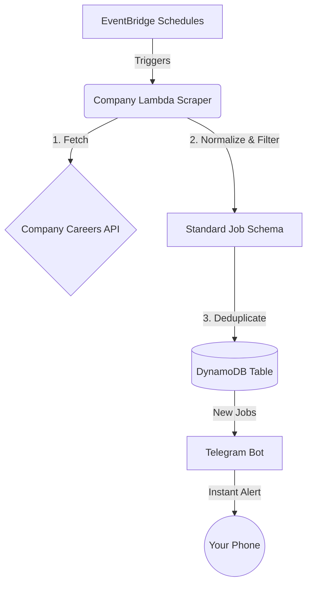

<div align="center">
  <h1>GAMMA Jobs Monitor 🚨</h1>
  <p><b>Never miss a top-tier engineering role again.</b></p>
  <p>A production-grade, serverless pipeline that monitors job postings from Google, Apple, Meta, Microsoft, and Amazon (GAMMA) and fires instant Telegram alerts.</p>
</div>

---

## 🎯 The Value Proposition

In today's competitive market, the best Software Development Engineer (SDE) roles close within days—sometimes hours. Constantly refreshing career pages is tedious and inefficient.

**GAMMA Jobs Monitor** automates the hunt. It programmatically polls the hidden APIs of top tech giants, filters for exactly what you want, ensures you never see duplicates, and delivers actionable alerts directly to your phone. All while costing you absolutely nothing in AWS infrastructure.

### ✨ Key Features
- **⚡ Real-Time Telegram Alerts**: Get notified the moment a new role drops. Digest includes job title, location, team, and a direct application link.
- **🧠 Intelligent Deduplication**: Backed by DynamoDB with a 90-day TTL. You will never be spammed with the same job twice.
- **🎯 Hyper-Targeted Filtering**: Automatically filters for SDE/SWE roles, USA locations, and strictly enforces a 24-hour freshness window.
- **☁️ Zero-Maintenance Serverless**: Built on AWS Lambda and EventBridge. Set it up once, and it runs forever with near-zero cost.

---

## 🚀 Live Integrations

Our modular strategy pattern allows us to rapidly plug in new companies. Here is the current status:

- ✅ **Amazon** — Live & Functional
- ✅ **Microsoft** — Live & Functional
- 🚧 **Google** — Coming Soon
- 🚧 **Meta** — Coming Soon
- 🚧 **Apple** — Coming Soon

---

## 🏗️ Under the Hood

The architecture is designed for scale, resilience, and cost-efficiency.



*For a deep dive into the architecture, codebase conventions, and future product roadmap, check out our [Documentation Directory](./docs).*

---

## 🛠️ Getting Started

Want your own private job pipeline? Here is how to deploy it in minutes.

### Prerequisites
- [AWS CLI v2](https://docs.aws.amazon.com/cli/latest/userguide/install-cliv2.html) configured with your credentials
- [AWS SAM CLI](https://docs.aws.amazon.com/serverless-application-model/latest/developerguide/install-sam-cli.html)
- Python 3.13

### 1. Create a Telegram Bot
1. Message **@BotFather** on Telegram and type `/newbot`.
2. Copy your **Bot Token** (`123456789:ABCdef...`).
3. Message your new bot, then visit `https://api.telegram.org/bot<TOKEN>/getUpdates` to grab your **Chat ID**.

### 2. Deploy the Pipeline
```bash
git clone https://github.com/your-username/gamma-jobs-monitor.git
cd gamma-jobs-monitor

# Build the serverless application
sam build

# Guided deployment to AWS
sam deploy --guided
```
*During deployment, SAM will ask for your Telegram Bot Tokens and Chat ID.*

---

## 🎮 Operations & Commands

Manage your deployment like a pro:

```bash
# Test a scraper locally (e.g., Microsoft)
sam local invoke MicrosoftJobsFunction

# Tail live logs in production
sam logs -n gamma-jobs-microsoft --tail

# Peek into the deduplication database
aws dynamodb scan --table-name gamma-jobs-amazon-seen \
  --query "Items[*].{ID:job_id.S,Title:title.S}"

# Push a new update
sam build && sam deploy
```

---

## 💸 Cost Breakdown

Because this pipeline uses highly optimized, ARM64-based Lambdas that only run for a few seconds per execution, **the entire system easily fits within the AWS Free Tier.**

| Service | Monthly Usage | Est. Cost |
|---|---|---|
| **AWS Lambda** | ~2,000 invocations | **$0.00** |
| **DynamoDB** | ~150 writes, ~2,000 reads | **$0.00** |
| **EventBridge** | ~2,000 events | **$0.00** |

---

<div align="center">
  <i>Stop searching. Let the jobs come to you.</i>
</div>
